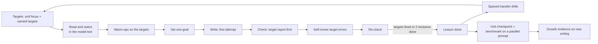

# Growth Loop — design doc

- **Author:** Claude (for chinhCom)
- **Created:** 2026-10-15
- **Authoritative copy:** `docs/superpowers/specs/2026-10-15-growth-loop-design.md`
- **Status:** Implemented behind `GROWTH_TARGETS` (off by default), as of 2026-10-16. D1–D4 were decided on 2026-10-15 (§13); D5 (pilot) is still open. The M3 precision gate has not passed, so target features stay off; current evidence is in `docs/verification/growth-loop.md`. Decision recorded after implementation: answers for target errors are hidden in the UI only, not removed from response data (accepted because the cost of a learner reading them in developer tools is low).
- **Depth:** Full design doc. The change runs for years, alters the pass rule for every lesson, adds curriculum content, and changes the AI feedback contract.

## 1. Objective

Make each lesson produce improvement that transfers to the learner's next new piece of writing, and show that improvement with evidence that compares like with like.

## 2. Background

### 2.1 Why now

The app records progress, but it does not cause or prove improvement. The learner-progress work (merge `5baa9bf`) made the records visible. It also made the gaps visible: the comparison mixes easy early tasks with harder later tasks, and a revision score can rise because the learner clicked "apply" on the coach's corrections.

### 2.2 The current loop, as built

`PROJECT.md` §1 describes the loop: mini-lesson with a model text → warm-ups → writing task → feedback → revision → error bank. The code implements each step separately. No step uses the result of the step before it.

| Observation (verified in code) | Location |
|---|---|
| A Core lesson is done after the warm-ups and **one** safe check of its task. Only checkpoint lessons need a minimum score. A lesson can pass with every score at 1. | `src/lib/curriculum-path.ts` (`passingChecks`) |
| Each unit has a `grammarFocus` (1–5 error tags). The grader never receives it. It receives only the task object. | `src/lib/curriculum.ts:66`, `src/lib/llm/grade.ts` |
| Feedback returns up to 3 `priorities`. Only `FeedbackView.tsx` reads them, to display them. | `src/lib/feedback/schema.ts`, `src/components/feedback/FeedbackView.tsx` |
| In a revision, the learner can apply the coach's suggestion to the draft with one click. The revision then contains the coach's words. | `FeedbackView.tsx:61-109`, `src/lib/revision.ts` (`revisionText`) |
| A Practice drill asks the learner to retype the coach's correction in their own sentence, with an exact phrase match. It tests one fixed instance, not the rule in a new sentence. | `src/lib/practice.ts` (`buildPracticeCards`, `checkPracticeAnswer`) |
| Per-tag mastery and `error_events` are targets in `PROJECT.md` §15. They are not built. | `PROJECT.md` §15 |
| The lesson shows a model text. No activity asks the learner to do anything with it. | `src/components/curriculum/LessonView.tsx` |
| The then-vs-now table compares the first 3 first attempts with the latest 3, whatever their task or level. | `src/lib/improvement.ts` |

### 2.3 Hosted data (2026-10-15, read-only query)

3 accounts, 31 submissions on 2 distinct tasks, 4 revisions, 33 applied corrections, 1 `lesson_progress` row, 1 placement, 36 Practice answers. A change to the pass rule or the feedback contract now affects test accounts only. That cost rises with each real learner, which is one reason to decide now.

## 3. What the research says

I searched OpenAlex and Semantic Scholar and chased forward citations from Brown et al. (2023) and Fleckenstein et al. (2023). The field is second-language (L2) writing, with general learning-science sources for spacing, feedback and mastery. Effect sizes are from the abstracts. I did not read the full texts. Many studies are classroom studies with a teacher, so the effects in a self-study app can be smaller.

| # | Finding | Evidence | Consequence for the design |
|---|---|---|---|
| R1 | Written corrective feedback improves accuracy. The effect is moderate and lasts over time. Direct, indirect and metalinguistic feedback give similar effects. | Kang & Han 2015 (21 studies), doi:10.1111/modl.12189; Brown, Liu & Norouzian 2023 (52 studies, Bayesian), doi:10.1177/13621688221147374 | Keep correction feedback. The type of feedback can be chosen for engagement, not for effect size. |
| R2 | Feedback in general has a medium effect (d = 0.48). The effect depends on the information it gives. | Wisniewski, Zierer & Hattie 2020 (435 studies), doi:10.3389/fpsyg.2019.03087 | Feedback must say what to do next, about a named target. |
| R3 | Automated writing feedback improves writing quality (g = 0.55–0.86). It helps vocabulary more than grammar. Longer use gives larger effects. LLM feedback improved revisions (d = 0.19) and motivation (d = 0.36). | Fleckenstein et al. 2023, doi:10.3389/frai.2023.1162454; Zhai & Ma 2022, doi:10.1177/07356331221127300; Ngo, Chen & Lai 2022, doi:10.1080/10494820.2022.2096642; Meyer et al. 2023, doi:10.1016/j.caeai.2023.100199 | The app's core mechanism is sound. Grammar needs more support than feedback alone. |
| R4 | **A better revision does not show that the learner learned.** Error reduction in a revision did not predict accuracy in new writing. Feedback improved revisions a lot, but its effect on new writing was mostly not significant. Revision time explained the revision gain, but not the transfer task. | Truscott & Hsu 2008, doi:10.1016/j.jslw.2008.05.003; Karim & Nassaji 2018, doi:10.1177/1362168818802469; Schiller et al. 2024, doi:10.1016/j.compedu.2024.105163 | Measure growth only on **new** writing. A revision is practice, not evidence. Today the app reports "revision gain" as improvement. |
| R5 | **Focused feedback transfers better than comprehensive feedback.** Feedback on 2 targets kept its advantage over 4 post-tests in 10 months. Focused feedback beat comprehensive feedback on new writing. | Bitchener & Knoch 2008, doi:10.1093/elt/ccn043; Ellis, Sheen et al. 2008, doi:10.1016/j.system.2008.02.001; Lira-Gonzales & Nassaji 2022, doi:10.3138/cmlr.2021-0061 | Each lesson works on 1–2 named targets. The grader reports on them first. |
| R6 | A chance to revise strengthens feedback, measured in new writing. Direct correction followed by revision was most effective. | Shintani, Ellis & Suzuki 2013, doi:10.1111/lang.12029 | Keep revision, but the learner must do the revision work. |
| R7 | Feedback that is manageable, meaningful, timely and constant (short frequent writing, error tallies) improved accuracy over a term. Traditional process writing did not. | Evans, Hartshorn & Strong-Krause 2011, doi:10.1016/j.system.2011.04.012; Kurzer 2017 (n = 325), doi:10.1002/tesq.366 | Short, frequent tasks with a running tally for each target. |
| R8 | Engagement decides whether feedback works. Learners differ in how deeply they process it. | Han & Hyland 2015, doi:10.1016/j.jslw.2015.08.002; Lau, Aubrey & Ellis 2024 (error logs), doi:10.1016/j.system.2024.103329 | Ask the learner to act on each target error before the app shows the answer. |
| R9 | Generative AI support can produce "metacognitive laziness": better task output with less self-regulation. | Fan et al. 2024, doi:10.1111/bjet.13544; Yan & Zhang 2024, doi:10.1057/s41599-024-03543-y | Show the corrected text and the `level_up_rewrite` after the learner tries, not before. |
| R10 | Spaced practice has a medium-to-large effect. Longer gaps work better for delayed retention. Equal and expanding gaps are equivalent. | Kim & Webb 2022 (48 experiments), doi:10.1111/lang.12479 | Bring each target back in later writing at growing intervals. The current Leitner intervals (1/3/7/14/30 days) can stay. |
| R11 | Reading instruction improves writing (ES 0.57). Writing about texts improves reading comprehension. Model texts used as feedback improved rewrites, mostly vocabulary. Text modelling gave more complexity growth than plain task repetition. Read-then-continue writing improved lexical sophistication. | Graham, Liu, Bartlett et al. 2017, doi:10.3102/0034654317746927; Graham & Hebert 2011, doi:10.17763/haer.81.4.t2k0m13756113566; Kang 2020, doi:10.1016/j.system.2019.102196; Abdi Tabari & Wang 2025, doi:10.1007/s11145-025-10660-w; Gao, Wang & Li 2026, doi:10.1177/13621688261471712 | Use reading **for** writing: notice features in the model text, and add read-to-write tasks (summary, continuation). |
| R12 | Writing instruction effects (ES): strategy instruction 0.82, summarization 0.82, peer help 0.75, product goals 0.70, sentence combining 0.50, study of models 0.25, isolated grammar instruction −0.32. Feedback from self 0.62 and from computers 0.38. | Graham & Perin 2007, doi:10.1037/0022-0663.99.3.445; Graham, Hebert & Harris 2015, doi:10.1086/681947 | Add goals and self-checks. Teach grammar in the learner's own writing, not as isolated drills. |
| R13 | Simple-to-complex task sequences gave steadier growth in complexity, accuracy, lexis and fluency. | Abdi Tabari & Cho 2022, doi:10.1177/13621688221090922 | Order tasks within a unit from simple to complex. |
| R14 | Mastery learning has positive effects, strongest for weaker students. It also increases time on task, and self-paced mastery courses can lower completion. | Kulik, Kulik & Bangert-Drowns 1990 (108 evaluations), doi:10.3102/00346543060002265 | A mastery gate needs an exit. Unlimited retries risk drop-out. |
| R15 | LLM essay scores are fairly reliable but change over time and across models. Agreement with humans varies with the learner's first language. A detailed rubric, a rationale, examples and averaging several ratings improve agreement. | Pack et al. 2024, doi:10.1016/j.caeai.2024.100234; Yancey et al. 2023, doi:10.18653/v1/2023.bea-1.49; Kim 2025, doi:10.1002/tesq.3405 | Pin the grader version for growth measurements. Calibrate the noise. Show only changes larger than the noise. |
| R16 | LLMs over-correct (no minimal edits). They miss cross-sentence tense and agreement errors. | Fang et al. 2023, doi:10.48550/arxiv.2304.01746 | A false target error is worse than a missed one (`PROJECT.md` principle 7). Validate the target report's precision before it gates progress. |

**Inferences, not findings:** the evidence comes mostly from classrooms with teachers, from university or school learners, and often from one or two grammar features (articles are over-represented). The effect of the whole loop in this app is unknown. The design must measure it (§9).

## 4. Goals

Each goal states the outcome and how it is measured. The numbers are initial targets for the pilot. Revise them after the calibration study (§9.3).

1. **Transfer.** Among learners who finish a unit, the median error rate on the unit's targets in the checkpoint task (new writing) is at least 25% lower than in the unit's first task.
2. **Like-for-like evidence.** Every learner who finishes a unit gets a growth result on parallel prompts scored by the same pinned grader. Progress shows a change only when it is larger than the measured noise.
3. **Engagement.** At least 70% of first attempts on lesson tasks are followed by a self-revision.
4. **Clarity.** At any time, the learner can see their 1–2 active targets, the evidence for each, and the next action. This needs no more than one screen on a phone.
5. **No dead ends.** No learner is blocked on a lesson for more than 2 revision attempts.

## 5. Non-goals

- **A separate reading or listening module.** Decided (D1): reading is added only where it serves writing (R11). A separate reading track would need its own design doc. `PROJECT.md` §1 is updated to match.
- **Official CEFR or IELTS results.** Scores stay practice scores (the existing disclaimer stays).
- **An adaptive engine with statistical models** (knowledge tracing or item response theory). They need much more data than 3 accounts. Rules are explainable and can be replaced later (§15).
- **Nightly AI-generated drills** (`PROJECT.md` §15 target). Authored items come first, because a wrong drill teaches a wrong rule (R16).
- **Peer review.** It has a large effect (R12), but it needs moderation, safety and a community. That is a separate project.
- **Native-language explanations.** `PROJECT.md` principle 5 already covers them. They are independent of this loop.
- **Teacher dashboards.** There are no teacher roles today.

## 6. The loop, as the learner sees it



### 6.1 Scenarios

1. **A learner starts a lesson.** Mai is at A2. The unit focus is `verb-tense` (past simple). Her record also carries `articles` from the last unit, because she passed it by carrying a target forward. Today shows: "Your targets: past tense (new), articles (from last unit)."
2. **Read and notice.** The lesson shows the model text. The noticing task says: "Tap the 4 verbs in the past tense." The app grades the taps locally. No AI call is needed. If she misses one, the app highlights it and shows the rule in one line.
3. **Set a goal.** Before she writes, Mai picks one goal from the task checklist, for example "Use past tense for every finished action."
4. **Write and check.** She writes 70 words. The check returns the normal scores and corrections. It also returns a target report: past tense used 9 times, 3 errors; articles used 6 times, 1 error. The feedback screen shows the target report first, then strengths, then at most 3 priorities.
5. **Self-revise.** Each target error is underlined with a one-line cue ("Finished action — which form?"). It has no apply button and does not show the answer. Non-target corrections keep the apply button, so the screen does not become a wall of red (principle 2). After she submits the revision, the app shows the answers and the `level_up_rewrite`.
6. **Pass.** The revision fixes 3 of 4 target errors and keeps the task on-topic. The lesson is done, through mastery. If after 2 revisions she still has target errors, the lesson is done through **carry-forward**: the target stays active and comes back in the next lesson's check.
7. **Practice.** Practice shows the existing "fix your own sentence" drills, plus authored **transfer drills** for her active targets: new sentences with the same structure. They follow the existing intervals.
8. **Checkpoint.** At the end of the unit, she writes on a prompt parallel to the unit's first task. The pinned grader scores it. Progress shows: "Past tense in new writing: 33% of uses wrong → 8% wrong (unit start → checkpoint)."

### 6.2 Interfaces that change (sketches)

Feedback screen, top section (new):

```
Your targets in this piece
  Past tense     ●●●●●●○○○   6 of 9 correct   [Fix 3 in your revision]
  Articles       ●●●●●○      5 of 6 correct   [Fix 1]
```

Progress, new "Targets" panel:

```
Past tense      learning   new writing: 33% → 8% wrong (3 tasks)   next review in 7 days
Articles        secure     new writing: 12% → 0% wrong (4 tasks)
```

Today: the existing next-task card adds one line, "Targets: past tense, articles."

## 7. Missing in v1 (deliberate)

- No per-learner difficulty adaptation inside a unit. The unit order is fixed (R13 favours simple-to-complex, and the authored order already does this).
- No timed fluency tasks. Draft timestamps are too coarse to measure writing speed.
- No AI grading of noticing tasks or drills. All of them are graded locally against authored answers.
- No change to the IELTS track's pass rule in the first milestones. IELTS units can be entered independently, so carry-forward needs a separate design.

## 8. Design decisions

Each decision states the choice, the reason, the cost and how hard it is to reverse.

### 8.1 Learning target: a tag plus a level

A **target** is an existing `ErrorTag` at a CEFR level, for example `verb-tense@A2`. Unit `grammarFocus` already uses these tags, so no new taxonomy is needed.

- *Reason:* the closed tag list is used everywhere (`PROJECT.md` §8). Adding a parallel "skill" list would split the data.
- *Cost:* some tags are broad (`word-choice`), and some are not grammar (`task-response`). Targets are limited to tags with authored content (§8.6). Others stay feedback-only.
- *Reversibility:* medium. Stored evidence is keyed by tag.

### 8.2 Evidence is stored; the target state is computed

A new owner-only table `target_evidence` stores one immutable row per check per target: `submission_id`, `tag`, `uses`, `errors`, `self_fixed` (revisions only), `is_first_attempt`, `is_benchmark`, `grader_version`. The state (new, learning, secure, review due) and the next review date are **computed on read**, like `summarizeProgress` and `summarizeImprovement` are today.

- *Reason:* rules will change after the pilot. A computed state changes with the code and never drifts. Recomputing is cheap at this scale.
- *Cost:* each Progress load reads every evidence row. At 20 checks a day that is under 30,000 rows a year per learner, which is acceptable. Add a summary table only if the load time exceeds the Progress budget.
- *Alternative:* a stored `skill_mastery` row per tag (`PROJECT.md` §15). It loses history, and a rule change needs a backfill.
- *Reversibility:* easy. The evidence table is the source, so a cache can be added later.

### 8.3 The feedback contract gains an optional `target_report`

The grader receives the active targets as trusted configuration. It returns, for each target, the number of uses, the number of errors, and the indexes of the matching corrections.

```ts
target_report: z.array(z.strictObject({
  tag: ErrorTag,
  uses: z.number().int().min(0).max(100),
  errors: z.number().int().min(0).max(100),
  correction_indexes: z.array(z.number().int().min(0).max(11)).max(12),
})).max(3).optional()
```

- *Reason:* an error rate needs a denominator. "Errors per 100 words" punishes a learner who tries the structure more often. Uses ("obligatory contexts" in second-language research) are the standard denominator.
- *Cost:* the model's count of uses is noisy (R15, R16). The server checks consistency: `errors ≤ uses`, every index points to a correction with the same tag, and `errors` equals the number of indexes. It drops the report when these checks fail. A prompt version bump is needed (`PROJECT.md` §12).
- *Risk:* a false target error blocks a pass. §9.2 sets a precision gate before the report is used for passing.
- *Reversibility:* medium. Old feedback has no report, which is why the field is optional.

### 8.4 Revision: self-fix for target errors, apply for the rest

Target corrections show an indirect cue and no apply button until the learner submits a revision. Non-target corrections keep the apply button. The submission stores `revision_kind`: `self` if the learner applied no target correction, otherwise `assisted`. The `level_up_rewrite` appears after the first revision, or after the learner chooses "Show me".

- *Reason:* R4, R8 and R9. Engagement and self-repair drive learning. One-click application turns revision into copying.
- *Cost:* more friction. Some learners will leave (R14). The "Show me" escape and the 2-revision limit bound the cost.
- *Reversibility:* easy. It is UI and a flag.

### 8.5 Pass rule: mastery with carry-forward

A Core lesson is done when the warm-ups are done, the latest check of its task is safe with `task ≥ 2`, and one of these is true:

1. **Mastery:** in the latest check, each target has `errors ≤ max(1, 20% of uses)`.
2. **Carry-forward:** the learner has submitted 2 revisions. Each target that missed rule 1 becomes a carried target. It joins the next lesson's targets, at most 2 targets in total. The unit focus wins when the list is full.

Checkpoint lessons keep the existing rubric floor (`PROJECT.md` §7.4). They also become the unit benchmark (§9.1).

- *Reason:* R14. Mastery helps weaker learners, and an exit prevents drop-out. Carry-forward keeps the target active, and spacing (R10) brings it back.
- *Cost:* existing `lesson_progress` rows have no `passed_via`. Lessons completed before the change keep their state and are marked `legacy`.
- *Until the precision gate in §9.2 passes:* the system computes the rule and stores the result, but it does not block. The current pass rule stays in force.
- *Reversibility:* easy. The pass state is computed (`buildCoursePath`).

### 8.6 Content: authored per target and level, and reviewed

New content for each Core unit:

- one noticing task on the model text (2–6 spans to find, graded locally);
- 4–6 transfer drill items for each focus tag;
- one parallel prompt for the checkpoint, matched in genre, length and level to the unit's first task.

Draft it with an AI, then send it through the existing teacher-review gate (`curriculum/review.json`, `curriculum/README.md`). Validate it with the existing Zod schemas, extended.

- *Reason:* R16 and principle 7. Local grading also keeps the cost near zero (principle 6).
- *Cost:* about 21 units × (1 noticing task + about 10 drills + 1 prompt). This is the largest cost in the project, and it blocks milestones M5–M7.
- *Reversibility:* easy. Content is data.

### 8.7 Spaced return of targets

A target that reaches `secure` gets a review date from the existing interval list (1, 3, 7, 14, 30 days). The next writing check after that date reports on it again. If it shows errors above the mastery threshold, it drops back to `learning`.

- *Reason:* R10. The spacing happens in real writing, not only in drills.
- *Cost:* a check can have at most 2 targets, so due targets wait their turn. The unit focus comes first.

## 9. Measurement

### 9.1 What counts as growth

- **Primary:** the target error rate (`errors / uses`) in **first attempts on new tasks**. Revisions are excluded (R4).
- **Benchmark:** the unit checkpoint is written on a prompt parallel to the unit's first task. The two are compared with the same pinned `grader_version`.
- **Deterministic indicators, computed in code with no AI:** word count against the task range, mean sentence length, and a lexical diversity measure (MTLD). They have no grader noise. They are shown as context, not as scores.
- **Removed:** "revision gain" stops being presented as improvement. It is shown as "how much you fixed", which is what it measures.

### 9.2 Precision gate for the target report

Before the pass rule blocks anyone:

1. Build an evaluation set: 40 learner texts (A1–B1) that contain the 5 most common focus tags. Annotate them by hand: one annotator plus a second check on 25% of them.
2. Run the grader 3 times on each text.
3. Gate: target-error precision ≥ 0.85 (flagged errors that are real), and ≤ 10% of runs disagree on the pass result.

The repo has `src/lib/evaluation.ts` and `docs/verification/ai-check.md`. Extend them; do not add a new harness.

### 9.3 Calibration of grader noise

Grade the same 30 texts 3 times with the pinned prompt and model. For each score and each target error rate, record the standard deviation. Progress shows "changed" only when the difference is larger than 2 × that value. Otherwise it shows "about the same". Repeat when the model or the prompt version changes (R15).

### 9.4 Product metrics (owner-only aggregates; no new personal data)

- the self-revision rate (goal 3);
- the lesson pass mode: mastery, carry-forward or legacy;
- the median number of revisions per lesson;
- drop-off: learners who start a lesson and do not return within 7 days, before and after the pass rule changes.

## 10. Timeline (ordered by value; each milestone ships on its own)

| Milestone | Implemented | Not yet implemented |
|---|---|---|
| **M1 Focused check** | The grader receives unit targets. `target_report` is validated and stored in `target_evidence`. The feedback screen shows the target section first. | Pass rule unchanged. Revision UI unchanged. |
| **M2 Self-revision** | Indirect cues and no apply button for target errors. `revision_kind`. Rewrite after a revision. "How much you fixed" replaces "revision gain". | Pass rule unchanged. |
| **M3 Evaluation gate** | §9.2 precision study and §9.3 noise calibration, with results in `docs/verification/`. | Pass rule still advisory. |
| **M4 Mastery pass** | §8.5 rule enforced for Core, with carry-forward and `passed_via`. Targets on Today and in the next lesson. | IELTS unchanged. |
| **M5 Targets in Progress** | A Targets panel with error rates in new writing and spaced review dates (§8.7). | No benchmark comparison yet. |
| **M6 Read and notice** | Noticing tasks on model texts for all Core units (content plus UI). | No read-to-write tasks. |
| **M7 Transfer drills** | Authored transfer items in Practice for active targets. | No AI-generated drills. |
| **M8 Benchmarks** | Parallel checkpoint prompts. Like-for-like growth in Progress with noise thresholds. Then-vs-now uses benchmarks. | — |
| **M9 Read-to-write tasks** | Summary and continuation tasks in later units (R11, R12). | Separate reading module (D1). |

M1 and M2 need no new content and give learners value at once. M3 must finish before M4. M6–M9 depend on content review.

## 11. Architecture and dependencies

- **Database:** Supabase Postgres, schema `writing`, Drizzle. New table `target_evidence` with row-level security per owner, like the other user tables. New columns: `submissions.revision_kind`, `lesson_progress.passed_via`. Each needs a migration. The tables are new, so the migration is additive and easy to reverse.
- **Grader:** DeepSeek through `src/lib/llm/grade.ts`. The prompt in `src/lib/prompts/feedback.system.md` gains a target section, and the version in `src/lib/prompts/version.ts` changes. The input grows by about 50 tokens. The output grows by about 60 tokens per target. This needs a check against `docs/verification/ai-latency.md`.
- **Content:** `curriculum/*.draft.json` plus the review files. The schemas in `src/lib/curriculum.ts` gain `noticing`, `transferDrills` and `parallelPrompt`, all optional, so content can be added unit by unit.
- **Computation:** pure functions in `src/lib/` (`targets.ts`), tested with Vitest. Loaders are added to the existing transactions (`progressInTransaction`, `pathInTransaction`). This is the same pattern as the learner-progress work.
- **No new third-party dependency.** MTLD is about 30 lines of code.

## 12. Risks

| Risk | Mitigation | Accepted? |
|---|---|---|
| False target errors block a pass. | §9.2 gate. Advisory mode until it passes. Carry-forward caps the cost at 2 revisions. | Mitigated |
| More friction makes learners leave (R14). | "Show me" escape. Carry-forward. Drop-off metric before and after M4. | Partly accepted: some friction is the intervention. |
| Grader drift changes scores without a learner change (R15). | `grader_version` on every evidence row. Compare only within one version. Recalibrate on change. | Mitigated |
| Content cost delays M6–M9. | M1–M5 need no new content. Optional schema fields allow unit-by-unit rollout. | Accepted |
| Learners game the self-revision by deleting hard sentences. | The re-check counts uses. A drop in uses for a target below half of the first attempt is reported as "avoided", not "fixed". | Mitigated |
| Prompt injection through learner text changes the target report. | The existing escaping and the trusted-configuration boundary stay. The server validates the report against the corrections (§8.3). | Mitigated |

**Privacy:** no new categories of personal data. The evidence rows are derived from feedback that is already stored, and they are deleted with their submission (`ON DELETE CASCADE`). The product metrics in §9.4 are aggregate queries, not new tracking.

## 13. Decisions

Decided by the product owner on 2026-10-15:

- **D1 Reading scope: reading for writing.** Noticing tasks on model texts (M6) and read-to-write tasks (M9). No separate reading track. `PROJECT.md` §1 is updated. *Rejected:* a separate reading track with comprehension questions (needs its own content and measure); writing only (leaves the model text unused).
- **D2 Pass rule: mastery with carry-forward**, as in §8.5. *Rejected:* strict mastery with no exit (R14: lower completion); keeping the current rule (no incentive to improve).
- **D3 Target-error answers: hidden until the first revision, with a "Show me" escape**, as in §8.4. *Rejected:* no escape (frustration); keeping the apply button (R4, R9).
- **D4 Content review: the product owner reviews AI drafts** through the existing review files (`curriculum/review.json`). The review speed sets the schedule for M6–M9.

Still open:

- **D5 Pilot.** *Recommendation:* run M1–M5 with 10–20 real learners for 4 weeks before M6. With 3 test accounts, no goal in §4 can be measured. *Next step:* the product owner decides who the pilot learners are and when the pilot starts.

## 14. Open issues

- **Targets on non-grammar tags.** `task-response`, `cohesion` and `paragraphing` have no countable "uses". *Options:* exclude them from targets, or use a rubric score as the measure. *Next step:* decide during M1 by checking which tags the Core units use as `grammarFocus`.
- **IELTS track.** Units are independent, so carry-forward has no "next lesson". *Next step:* separate short design after M4.
- **Placement as baseline.** The placement sample could serve as benchmark 0. Its prompt is not parallel to unit tasks. *Next step:* check during M8 whether placement prompts can get parallel forms.

## 15. Alternatives considered

- **More corrections per check (comprehensive feedback).** Rejected: focused feedback transfers better (R5), and the current wall-of-red limit (principle 2) agrees.
- **Knowledge tracing or item response theory for mastery.** Rejected for v1: it needs much more data, and it is hard to explain to a learner. The evidence table keeps this option open.
- **Stored mastery scores (`PROJECT.md` §15 `skill_mastery`).** Replaced by computed state (§8.2).
- **AI-generated drills at answer time.** Rejected: there is a cost per answer, and the accuracy risk is R16.
- **Using revision gain as the main progress measure.** Rejected: R4.

## 16. References

All cited by DOI in §3. The search used the OpenAlex and Semantic Scholar APIs, with forward-citation chases from doi:10.1177/13621688221147374 and doi:10.3389/frai.2023.1162454. One result in the chase was retracted (doi:10.1016/j.caeo.2025.100249), and it is not used.
